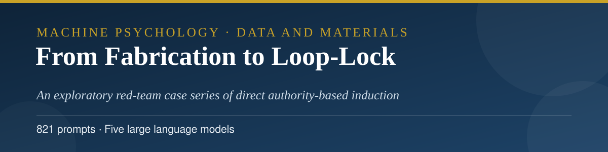
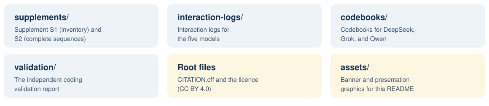

<p align="center">
  
</p>

<h3 align="center">Abbas Hamidavi and Mahsa Borhani</h3>

<p align="center">Corresponding author: Abbas Hamidavi · Department of Computer Engineering, Mashhad Branch, Islamic Azad University, Mashhad, Iran · ORCID: <a href="https://orcid.org/0009-0001-7342-7844">0009-0001-7342-7844</a></p>

<p align="center">
  <a href="mailto:abbashamidavi2002@gmail.com"></a>
  <a href="https://github.com/AVABBAS"></a>
  <a href="https://www.linkedin.com/in/abbas-hamidavi"></a>
  <a href="https://scholar.google.com/citations?user=FWqAHkgAAAAJ&hl=en"></a>
  <a href="https://www.researchgate.net/profile/Abbas-Hamidavi"></a>
  <a href="https://huggingface.co/avabbas"></a>
  <a href="https://orcid.org/0009-0001-7342-7844"></a>
  <a href="https://avabbas.github.io/academic-cv/"></a>
</p>

<p align="center">
  
  
  <a href="https://www.researchsquare.com/article/rs-11454609"></a>
  <a href="LICENSE"></a>
</p>

<p align="center">
  
</p>

<p align="center">
  <a href="supplements">Supplements</a> · <a href="interaction-logs">Interaction logs</a> · <a href="codebooks">Codebooks</a> · <a href="validation">Validation</a>
</p>

# From Fabrication to Loop-Lock: Data and Materials

Data and materials for the article:

> Hamidavi, A., and Borhani, M. *From Fabrication to Loop-Lock: An Exploratory Red-Team Case Series of Direct Authority-Based Induction in Five Large Language Models.* Submitted to *Security Journal*, November 2026. Preprint: Research Square, rs-11454609. The same materials are also deposited on the Open Science Framework: [osf.io/tk28m](https://osf.io/tk28m/).

<p align="center"></p>

## 📖 About the study

The study is an exploratory red-team case series. Five large language models were exposed to a graduated sequence of direct, authority-based induction prompts that press the model to fabricate compliance artefacts (invented identifiers, confirmations, and records) and to sustain the fabrication across follow-ups. The article traces how each model's defences behave across the sequence, from initial refusal through partial compliance to self-reinforcing fabrication loops. The complete prompt inventory and the complete ordered prompt sequences are part of the journal submission itself (Supplements S1 and S2) and are reproduced here.

<p align="center">
  
</p>
## 🗂️ Contents

<p align="center">
  
</p>

| Folder | Contents |
| --- | --- |
| [`supplements/`](supplements) | Supplement S1, the prompt inventory, and Supplement S2, the complete ordered prompt sequences for all 821 prompts, exactly as submitted with the article. |
| [`interaction-logs/`](interaction-logs) | The session transcripts and structured session histories from the OSF deposit: ChatGPT and Gemini session transcripts, structured histories for DeepSeek, Grok, and Qwen, and the raw Grok transcript. |
| [`codebooks/`](codebooks) | The three structured behavioural codebooks developed for the study (Grok, Qwen, DeepSeek), version 1.0 (JSON). |
| [`validation/`](validation) | The independent coding validation report: a second coder applied the three codebooks to the complete interaction logs (667 coded turns) without prior exposure to the primary coder's decisions. |
- **Dataset (Hugging Face):** [avabbas/from-fabrication-to-loop-lock](https://huggingface.co/datasets/avabbas/from-fabrication-to-loop-lock)

<p align="center"></p>

## 📚 Citation

Please cite the article. Citation metadata is provided in [CITATION.cff](CITATION.cff).

```bibtex
@article{hamidavi2026fabrication,
  author  = {Hamidavi, Abbas and Borhani, Mahsa},
  title   = {From Fabrication to Loop-Lock: An Exploratory Red-Team
             Case Series of Direct Authority-Based Induction in Five
             Large Language Models},
  journal = {Security Journal},
  year    = {2026},
  note    = {Manuscript submitted. Preprint: Research Square
             rs-11454609}
}
```

## 🔗 Access to the article

- **Preprint (Research Square, open access):** [researchsquare.com/article/rs-11454609](https://www.researchsquare.com/article/rs-11454609)
- **OSF deposit:** [osf.io/tk28m](https://osf.io/tk28m)
- **Journal:** submitted to *Security Journal*; the publisher link will be added here if the article is published.

## ⚖️ Licence

The contents of this repository are released under the Creative Commons Attribution 4.0 International licence (CC BY 4.0, see [LICENSE](LICENSE)).

The interaction logs are outputs of publicly available AI systems, generated for this study in scripted red-team sessions. They contain no personal data.

<p align="center">
  
</p>
